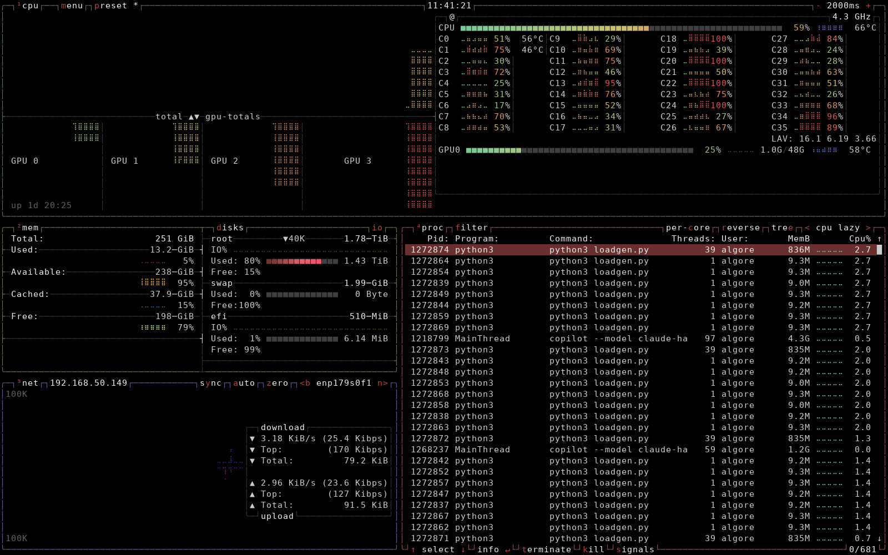

# pybtop

> **Your whole machine, at a glance, in pure Python.** CPU, memory, disks, network, processes and NVIDIA GPUs in one btop-style terminal dashboard, with zero third-party dependencies.



A clean-room Python re-implementation of the [btop++](https://github.com/aristocratos/btop) 1.3.0
terminal resource monitor, reverse engineered from the installed binary and its observable behaviour.
It uses only the Python standard library (plus `ctypes` for NVIDIA NVML).

See [docs/REVERSE_ENGINEERING.md](docs/REVERSE_ENGINEERING.md) for how the behaviour was derived,
what was verified, and what is not reproduced.

## Requirements

- Linux (reads `/proc` and `/sys`)
- Python 3.10+
- A UTF-8 locale and an interactive terminal of at least 80x24
- Optional: NVIDIA driver (`libnvidia-ml.so`) for GPU boxes; `/usr/share/btop/themes` for the shipped themes

## Run

```sh
python3 -m pybtop                 # from this directory
python3 -m pybtop -p 1 -u 1000    # start with preset 1 and a 1 s update interval
python3 -m pybtop -lc             # low-colour (256-colour) output
```

Command-line flags, error messages and exit codes follow btop 1.3.0 (`-h`, `-v`, `-lc`, `-t`, `+t`,
`-p`, `-u`, `--utf-force`, `--debug`).

## Keys

| Key | Action |
|---|---|
| `q`, `Ctrl+C` | Quit |
| `h`, `?`, `F1` | Help (2 pages; `↓` / `↑` to page) |
| `o`, `F2` | Options (`↑ ↓` select, `←` `→` / Enter change, `Esc` close) |
| `Esc`, `m` | Menu (Options / Help / Quit) |
| `1`–`4` | Toggle CPU / MEM / NET / PROC boxes |
| `5` | Toggle GPU boxes |
| `d` | Toggle disks sub-box in MEM |
| `p` / `P` | Cycle presets forwards / backwards |
| `+` / `-` | Update interval ±100 ms |
| `↑ ↓ PgUp PgDn Home End` | Move in the process list |
| `←` `→` | Previous / next sort column |
| `r` | Reverse sort |
| `e` | Tree view (`Space` or `+` / `-` expand and collapse the selected node) |
| `c` | Per-core process CPU% |
| `f` or `/` | Filter (Enter applies, Esc cancels; `Delete` clears) |
| `b` / `n` | Previous / next network interface |
| `a`, `y`, `z` | Net auto-scale, synced scale, reset totals |
| Enter | Toggle the process detail panel for the selected process |
| `t`, `k`, `s` | SIGTERM / SIGKILL / enter a signal number, each behind a `y` confirmation |

Mouse input works as in btop: click buttons, menus, process rows, per-core and disk/net controls,
and scroll the process list with the wheel.

## Configuration

Settings live in `$XDG_CONFIG_HOME/pybtop/btop.conf` (default `~/.config/pybtop/btop.conf`), in the
same `key = value` format and with the same key names as btop. pybtop writes this file only when
settings change, and never touches `~/.config/btop/`. User themes go in `~/.config/pybtop/themes/`;
the system themes in `/usr/share/btop/themes` are read as well. Saving keeps the existing file's
comments and unknown keys and rewrites only the values that changed.

`--debug` writes a btop-style log to `$XDG_CONFIG_HOME/pybtop/btop.log` (default
`~/.config/pybtop/btop.log`); nothing is logged to the terminal.

## Layout of the code

```
pybtop/
  cli.py              argument parsing, locale/tty checks, exit codes
  app.py              state, sampling loop, key handling, terminal loop, config saving
  config.py           btop.conf parsing and writing
  defaults.py         default value for every config key
  presets.py          preset string parsing and selection
  theme.py            theme files and the built-in Default palette
  keys.py             escape-sequence decoding
  fmt.py              floating_humanizer (btop's size/rate formatting), percentages, temperatures
  collectors/         /proc and /sys readers (cpu, memory/disks, network, processes, sensors/GPU)
  render/ansi.py      ANSI output, colour handling, gradients, cell canvas
  ui/pen.py           btop drawing core: 1-based cursor pen, createBox, Meter, braille Graph
  ui/layout.py        box rectangles from btop's calcSizes (GPU build)
  ui/btop_cpu.py      CPU box (graphs, per-GPU columns, meter sub-box, per-core rows, GPU rows)
  ui/btop_boxes.py    MEM, NET and PROC boxes
  ui/palette.py       resolved theme colours for drawing
  ui/overlays.py      help, options, menu and prompt overlays
tests/                pytest unit tests (parsers, arithmetic, layout, graph/humanizer, key decoding)
```

## Tests

```sh
python3 -m pytest -q tests
```

## Known differences from btop

- At the default configuration the full-screen frame is a port of btop 1.3.0's layout and drawing rules. Against btop captures at 80x24, 120x40 and 160x50, box-drawing glyphs match 99–100%. The remaining differences are live values (percentages, process rows, disk I/O and the selection counter).
- Battery and ZFS support were checked only against fake sysfs and fixture text: the reference machine has no battery or ZFS. ZFS pool I/O counters (`objset` kstats) are not read, so ZFS disks show no I/O graph.
- The disk I/O badge on the MEM top border is not drawn at 160x50, and with `proc_left` one disk label cell in MEM can be off.
- The process detail panel's memory value is RSS from `stat`; btop reads smaps. Tree corner glyphs are not reproduced.
- Column-header clicks are not mapped (btop 1.3.0 has no such mapping); sorting uses the `<` / `>` arrows.
- `log_level` is not implemented; a SIGTERM or SIGKILL exit skips the final log line and config save.
- `cpu lazy` sorting follows btop's source: processes are ordered by lifetime CPU and re-sorted every refresh, not only on the top process's cycle.
- The menu labels and the confirmation dialogs for `t`/`k`/`s` are this project's own design: btop's menu labels and dialogs were not observable.
- The TTY theme uses btop 1.3.0's built-in 16-colour table (from upstream `src/btop_theme.cpp`), not a rendered `btop --tty` capture comparison.
- Attribution: the geometry and drawing rules in `pybtop/ui/` follow btop's Apache-2.0 source (v1.3.0), cross-checked against the installed binary's screens. See docs/REVERSE_ENGINEERING.md.
